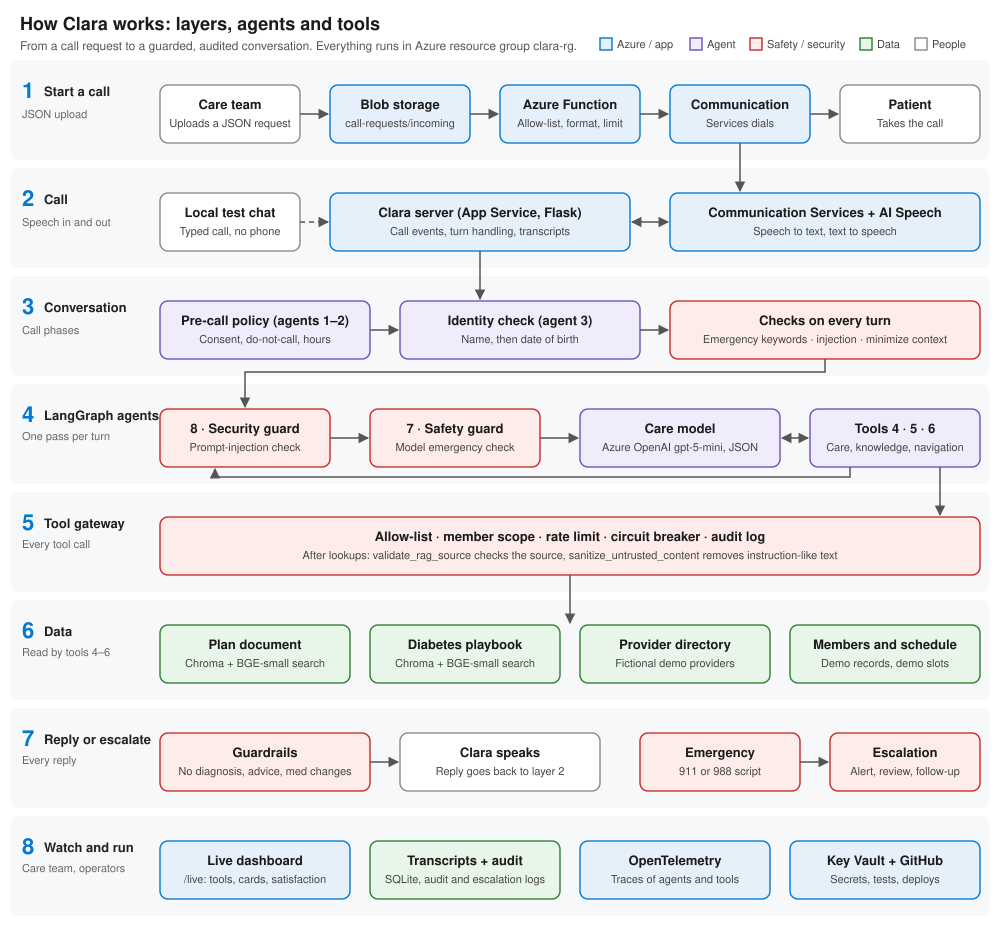
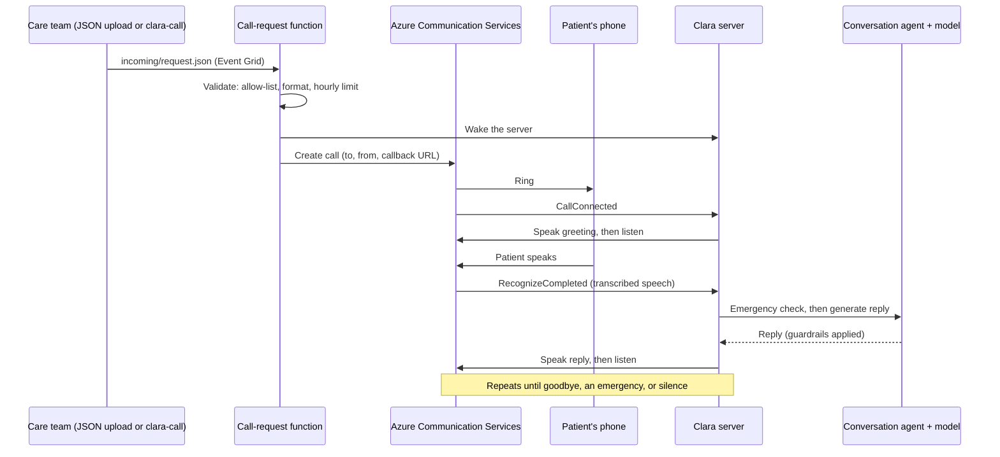

# Architecture

How Clara works today, and why it's built this way. For the long-term product vision, see the [target design](./target-design.md).

## Components

All Azure resources live in one resource group, `clara-rg`.

| Component | Azure service | Role |
|---|---|---|
| **Clara server** | App Service (Linux, Python 3.12) | Receives call events, runs each conversation turn, serves the live dashboard |
| **Call-request function** | Azure Functions (Flex Consumption) | Validates uploaded JSON requests and starts calls |
| **Call-request storage** | Blob Storage + Event Grid | The `call-requests/incoming/` inbox; Event Grid triggers the function for each new `.json` file |
| **Phone calls** | Azure Communication Services (ACS) Call Automation | Clara's phone number; dials patients, plays Clara's voice, transcribes the patient |
| **Speech** | Azure AI Services (Speech) | Neural text-to-speech and speech recognition, used by ACS |
| **Conversation model** | Azure OpenAI (`gpt-5-mini`), or Anthropic Claude | Drafts Clara's replies and makes the per-turn safety check; `LLM_PROVIDER` picks one |
| **Agent graph** | LangGraph, inside the Clara server | Routes each turn through the security and safety checks, the care model and eight capability tool nodes ([details](./architecture/workflow-and-tools.md)) |
| **Local search** | Chroma + FastEmbed, inside the Clara server | Search indexes for the plan document, diabetes playbook and provider directory |
| **Escalation and audit logs** | Inside the Clara server | Emergency escalation records and the security audit log; kept in memory, optionally in files |
| **Secrets** | Key Vault | Keys and passwords, read by the apps through managed identities |
| **Delivery** | GitHub Actions | Lint and tests on every push; deploys on merge to `main` |

## How a call works

1. **Start.** A JSON request lands in `call-requests/incoming/`, or someone runs `clara-call`. The function checks the request, wakes the server and asks ACS to dial.
2. **Connect and verify identity.** When ACS sends `CallConnected`, Clara introduces herself as an automated Blue Cross Blue Shield care management assistant and asks for the caller's full name. GPT invokes `verify_full_name` and reviews its result; a matching first name or bounded phonetic spelling variant can pass this first step. Clara then asks for month, day and year of birth. GPT invokes `verify_dob` and reviews the result against the server-owned record. Only both successful steps unlock the reason for outreach. A mismatch plays an apology and disconnects after playback; service failures get an unavailable message. See [the live identity flow](architecture/workflow-and-tools.md#live-identity-verification).
3. **Each turn.** ACS transcribes the patient and sends `RecognizeCompleted`. The server redacts phone numbers and other identifiers from the copy shown on the dashboard and saved in the transcript. The agent ([`conversation.py`](../hcm_agent/agent/conversation.py)):
   1. runs an **instant keyword check** for emergencies, such as "chest pain" or "want to die". On a match it skips the model entirely.
   2. runs the **prompt-injection check**. An attempt ("ignore your instructions") gets a fixed reply, never reaches the model, and is recorded in the audit log.
   3. runs the **LangGraph capability graph** ([details](./architecture/workflow-and-tools.md)): a security guard, a **model-based safety check**, then the care model, which may call tools such as the plan-document or provider search. It receives only the context it needs, and search results are checked against registered sources and cleaned of hidden instructions first. The answer is structured JSON: Clara's reply, a **clinical emergency assessment**, the patient's **sentiment** (0–1: how satisfied they seem with the call at that moment), and the **conversation state**.
   4. runs the reply through the **guardrails**, replacing diagnoses, medical advice and medication changes with honest, safe wording.
   5. asks ACS to speak and listen again. A reply that takes more than 8 seconds gets a short "I'm checking that now"; after 15 seconds Clara apologizes and moves on.
4. **End.** A call ends in one of these ways:

   | Ending | What Clara does |
   |---|---|
   | The patient's needs are met | Asks *"Is there anything else I can help you with today?"*; the model judges when the patient is done, including a goodbye, and moves to the closing |
   | Closing | Asks *"Would you like a short feedback form by text message?"*, records yes or no, thanks the patient and hangs up |
   | Emergency | Plays a fixed message (911, or the 988 crisis line for mental-health crises), records an escalation for the care team, and hangs up |
   | Identity not verified | Apologizes and hangs up; nothing health-related is said |
   | Patient not available or wrong number | Notes a good time to reach the patient (or apologizes) and hangs up |
   | Silence | Re-asks once, then says goodbye |

   The transcript and a call summary go to the server log, and finished calls are saved locally so the dashboard can show them after a restart.

Each event is acknowledged immediately and handled in the background, so a slow model reply never times out the call. One shared model connection serves every call, and a warm-up request goes out while the greeting plays, so the patient's first turn is as fast as the rest (about 2 seconds).

## Guardrails

1. **System prompt** ([`prompts.py`](../hcm_agent/agent/prompts.py)): Clara never diagnoses, gives medical advice or suggests medication changes, and **makes no promises**. She can't connect, transfer, schedule, send or arrange anything, or commit anyone to call back. The only thing she offers is to note something for the care team.
2. **Response check** ([`guardrails.py`](../hcm_agent/agent/guardrails.py)): every reply is scanned for diagnosis, medical-advice and medication-change patterns, including softer directives such as "keep taking it as prescribed". A match replaces it with a safe fallback. Asking or talking about medication, food and routines is allowed. The separate promise check was removed, so promises now rely on the prompt alone.
3. **Emergencies, four layers:**
   - **Keywords:** an instant check, such as "chest pain" or "want to die".
   - **The safety agent:** a short model check at the start of every turn, before the care model, which also applies the keyword list.
   - **The model's clinical assessment:** it recognizes, in everyday words, severe low blood sugar (shaking, confusion, sweating), diabetic ketoacidosis (vomiting, fruity breath), stroke and heart-attack signs, breathing trouble, and suicidal thoughts.
   - **Azure's content-safety filter:** when it blocks a message as self-harm, Clara treats it as a mental-health crisis, never brushes it off.

4. **Escalation, through the safety tools** ([`tools/safety.py`](../hcm_agent/tools/safety.py)): whichever layer catches an emergency, the same six tools run. They confirm the emergency and its kind, choose the care-team queue (nurse triage or behavioral-health crisis), and record an **urgent alert**, a **clinical review task** and a **safety follow-up** due the next business day. The last tool returns Clara's fixed 911 or 988 wording. She says *"I'm also flagging this call for your care team"* only when the alert was actually recorded, and a failure to record never delays or blocks the emergency message.

   Records hold the kind, a short reason, the member ID, the call ID and the queue: no names, dates of birth, phone numbers or transcripts. They are **recorded, not dispatched**: no care-team system is connected yet, so someone has to read the log, the dashboard or the webhook channel. See [Operations](./operations.md#emergency-escalations).

5. **Security checks** ([`tools/security.py`](../hcm_agent/tools/security.py)): rule-based and deterministic, so the model can't switch them off.
   - **Prompt injection** is blocked before any model sees the caller's words, in the identity steps and in the conversation.
   - **Personal data** (phone, email, card, SSN, stated date of birth, member ID) is redacted from the dashboard, saved transcripts, server logs and escalation records.
   - **Context minimizing:** the prompt and tools receive only the fields they need.
   - **Search results** must come from a registered source, carry approval and date warnings, and have instruction-like text removed.
   - **Audit and limits:** every tool call and policy decision goes to an audit log, and ordinary tools are rate-limited per call.

   Which of the 17 security tools are real is tracked in [`STATUS.md`](../hcm_agent/tools/.md%20files/STATUS.md).

Every blocked reply, blocked attempt, emergency and escalation appears on the live dashboard, including which layer caught it.

## Live dashboard

The `/live` page shows each call as it happens:
- **Turns:** what the patient said (with speech-recognition confidence) and Clara's replies, with timings.
- **Sentiment:** how satisfied the patient seems with the call at that moment, not how hard their situation is. It starts at 0.50 (neutral) and updates every turn. It shows a score, a label (Dissatisfied below 0.35, Satisfied above 0.65), and a trend line, all in the panel at the top of the call. Each reading is smoothed (60% new, 40% previous) so one remark doesn't swing it.
- **Guardrails, security and emergencies:** blocked replies, blocked prompt-injection attempts, and emergencies with the reason and which layer caught them, followed by what was recorded for the care team (queue and record IDs).
- **Tools and agents:** the tools that ran on each turn under Clara's reply, and a "Tools & sources" tab with the agent trace.
- **Call quality:** summary cards (identity verified, average satisfaction, follow-up priority) and a response-time chart.
- **Privacy:** patient messages with identifiers removed are tagged "Personal identifiers redacted"; identity answers show as "[Identity answer provided]".
- **Endings:** how each call ended, and whether the patient asked for the feedback form.
- **Who answered:** whether the patient confirmed their identity, or who answered instead and the good time to call back.

The feedback answer is recorded but no text is sent yet: the ACS trial number can't send SMS. Sending it is on the [roadmap](./roadmap.md).

## Code layout

| Path | Purpose |
|---|---|
| [`hcm_agent/config.py`](../hcm_agent/config.py) | Every setting, read from the environment or `.env`, checked at startup |
| [`hcm_agent/agent/`](../hcm_agent/agent/) | The conversation: `conversation.py` (call state and guardrail enforcement), `llm.py` (Azure OpenAI or Claude), `prompts.py`, `guardrails.py` |
| [`hcm_agent/workflows/`](../hcm_agent/workflows/) | Native LangGraph model/tool loop, mandatory pre-call authorization, and verified-member care |
| [`hcm_agent/tools/`](../hcm_agent/tools/) | Domain tool contracts and the gateway that enforces actor, tenant, purpose, scope, and member boundaries; `safety.py` holds the emergency keywords, fixed emergency wording and the escalation log. [`STATUS.md`](../hcm_agent/tools/STATUS.md) says which tools are real |
| [`hcm_agent/telephony/`](../hcm_agent/telephony/) | Calls: `server.py` (ACS events, `/live`), `outbound.py` (legacy and policy-authorized dialing), `call_requests.py` (request validation), `live_feed.py` and `static/live.html` (dashboard) |
| [`hcm_agent/cli/`](../hcm_agent/cli/) | `clara-call` (place a call), `clara-chat` (talk to Clara in the terminal) and `clara-interactive-chat` (a typed test call in the browser) |
| [`data/`](../data/) | Demo member records, the plan policy PDF, the diabetes playbook, the fictional provider directory, and saved test-call transcripts. Search indexes are built under `data/vectorstore/` and not committed |
| [`.github/pr-review/`](../.github/pr-review/) | The on-demand PR reviewer and its instructions (see [Contributing](./contributing.md#automated-pr-review)) |
| [`hcm_agent/azure_functions/`](../hcm_agent/azure_functions/) | The call-request Azure Function, deployed separately |
| [`hcm_agent/deploy/`](../hcm_agent/deploy/) | Deploy, start and stop scripts, and the packaging script |
| [`tests/`](../tests/) | Automated tests, with stand-ins for ACS, the models and Azure Storage |
| [`config/.env.example`](../config/.env.example) | Every setting, documented |

The Azure Function and the deploy scripts live inside `hcm_agent/` for a tidy repository, but they aren't part of the app that runs on the server. The packaging script and `pyproject.toml` exclude them.

## Security model

| Concern | How it's handled |
|---|---|
| Secrets | `.env` locally (never committed); **Key Vault** in Azure, read through managed identities |
| Call events | ACS posts to a callback URL containing a secret key (`PHONE_WEBHOOK_KEY`); other requests are rejected |
| Who can be called | Only numbers in `ALLOWED_CALL_NUMBERS`, at most `MAX_CALLS_PER_HOUR` per hour; trial numbers can call only verified numbers |
| Live dashboard | Password over HTTPS on Azure, local-only otherwise; call text never rendered as HTML |
| Call-request storage | Private container; each file processed once (blob lease), then moved to `processed/` or `failed/` |
| Speech access | ACS uses its managed identity (Cognitive Services User), so there's no extra key |
| Prompt injection | Caller words are checked before any model sees them; attempts get a fixed reply and are audited |
| Personal data | Redacted from the dashboard, saved transcripts, server logs and escalation records; prompts and tools get minimized context |
| Tool access | Every tool call goes through a gateway that checks the allow-list, permissions and member scope, writes an audit entry and applies a per-call rate limit |
| Retrieved content | Only registered sources reach the model, with hidden instructions removed |

Gaps before production are listed in the [roadmap](./roadmap.md#path-to-real-patient-calls).

## Key decisions

**Host on Azure App Service** (2026-09-30). The phone service needs a permanent public `https://` address. Early prototypes ran on a laptop behind a tunnel, which wasn't shareable or reliable. App Service gives managed HTTPS and a fixed address. The Free tier sleeps when idle, so callers wake it before dialing; Basic (B1) is always on. Calls are kept in memory in a single worker, so scaling out later needs shared call state. *Considered:* Container Apps (more setup than needed now) and Functions for the server (a poor fit for in-memory call state).

**Keep secrets in Key Vault** (2026-10-01). Secrets were first copied into plain app settings, and an early commit exposed keys that then had to be rotated. Now the deploy scripts write every secret to one Key Vault, and each app reads it through its own managed identity, which has read-only access. Developers keep a local `.env` so tests and local runs don't need Azure access. *Considered:* plain app settings (scattered and widely visible) and reading the vault on laptops too (every developer would need vault access).

**Azure OpenAI by default, with Claude as an option** (2026-09-30). Keeping the model in Azure puts everything under one subscription, bill and BAA. Both backends sit behind one interface and share the same prompts and guardrails, so switching is one setting. `gpt-5-mini` needs minimal reasoning effort to reply in about 2 seconds, fast enough for voice. *Considered:* either provider alone (less flexibility, or a second vendor).

**Deterministic security checks in front of the model** (2026-10-12). Prompt-injection blocking, redaction, context minimizing and source checks are rules in code, run through the tool gateway, rather than instructions to the model. A model can be talked out of an instruction; it can't skip a check that runs before it is called. They are drafts: rule-based checks miss unusual wording, which is why a model-based check is the next step. *Considered:* asking the model to police itself (cheaper, but not a boundary).

**Azure Communication Services instead of Twilio** (2026-10-01). Twilio's trial had three problems: a roughly 5-second webhook deadline that forced a hold-and-poll workaround, a cap of about 10 redirects that cut calls short, and a "press any key" notice on every call. HIPAA use would also have needed a separate Twilio BAA. ACS keeps the whole system in Azure, and its event model removes those workarounds. A real call verified the switch: greeting, speech recognition, emergency handling and hang-up all worked. The Twilio version is preserved on the `twilio-main` branch. *Considered:* staying on Twilio, and other carriers (Vonage, Plivo, Bandwidth) tried during early prototyping.

## Current limitations

- **Calls stay in memory:** in-progress calls and dashboard history clear when the server restarts (deploys, Free-tier sleep).
- **One server process:** fine for a prototype; scaling out needs shared call state.
- **Trial phone number:** 30 days, up to 3 verified numbers, 60 outbound minutes, 5-minute calls.
- **Slower turns with lookups:** each turn can make several model requests (safety check, care model, tool review), so replies that use a lookup can take 7 to 13 seconds.
- **Rule-based security checks:** unusual wording can get past them.
- **Escalations are recorded, not dispatched,** and the audit, rate-limit and escalation state is per process.
- **Demo content:** the plan document is a 2025 summary and the playbook is a draft pending clinical review.
