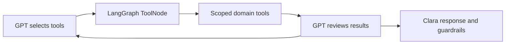

# LangChain / LangGraph workflow and tools

Clara now uses real LangGraph and LangChain, not a local imitation of their APIs.

## Read the implementation in this order

| File | Responsibility |
|---|---|
| `hcm_agent/workflows/graph.py` | Native `StateGraph`, `MessagesState`, `ToolNode`, and `tools_condition`; a bounded model/tool loop |
| `hcm_agent/agent/llm.py` | LangChain `ChatOpenAI` for the existing Azure v1 endpoint, or `ChatAnthropic` |
| `hcm_agent/tools/catalog.py` | Eight families of typed `StructuredTool` definitions |
| `hcm_agent/tools/gateway.py` | Actor, scope, tenant context, member boundary, and in-memory audit checks |
| `hcm_agent/tools/domains.py` | Business rules and clearly identified reference adapters |
| `hcm_agent/agent/conversation.py` | Call phases, approved introduction, emergency responses, and response guardrails |

## Eight families

Outreach eligibility; communication/accessibility; identity; care context/follow-up;
approved guidance; benefits/navigation/requests; safety/escalation; security/operations.

GPT selects the tools relevant to the question and sees their actual results before responding.
The model receives question/answer schemas; the application binds expected identity, member scope,
policy inputs and source records. It cannot supply a different member ID or override expected DOB.

Reference tools are callable, but not live integrations. Benefits and guidance use the selected
record's optional `profile` data. Scheduling, callback, human-review and urgent-alert tools report
`not_configured` until real adapters are connected. No fake task IDs or successful bookings are returned.

## Live identity verification

Clara introduces herself and asks for a name. GPT invokes the name tool through LangGraph, then reviews
the result. First-name answers and bounded phonetic variants can pass the name step.
Clara then requests DOB; GPT normalizes the spoken date and invokes the DOB tool.
A failed tool result cannot be overridden by GPT. Mismatches end the call politely;
model/service errors get the separate unavailable message. Identity answers are masked in stored transcripts.

This flow applies when the phone number has a member record. A number without one is called from
its call request alone: Clara confirms the patient by name ("May I speak with {name}, please?"),
notes a callback time if someone else answers, and the model replies without the member tools.
Set `MEMBER_RECORD_REQUIRED=true` to refuse such numbers instead; a missing record then fails
verification and ends the call.

The phone server selects the expected member by phone number; terminal chat selects the configured
member before the simulated call. Records come from `MEMBER_DATA_PATH` or `data/demo_members.json`.
Both server and Function deployment packages include the default demo dataset.

## Outbound calls

CLI and Azure Function use `place_member_call`. For a number with a member record:
1. GPT invokes the mandatory preflight tool, which evaluates stored consent, DNC, frequency, local time and contact.
2. GPT reviews the result; approval alone cannot bypass a failed check.
3. GPT invokes the authorized ACS call tool once and reviews the actual result.

The low-level `place_call` function remains an ACS adapter, not the application entry point.
Policies stay deterministic; model interpretation never substitutes for consent.

A number without a member record skips these steps and is dialed directly (the allow-list and
hourly limit still apply), unless `MEMBER_RECORD_REQUIRED=true`. Because steps 1 to 3 use the
model, the Azure Function needs the model settings; `deploy_function.ps1` adds them.

## Structured replies

Each care turn must come back as one JSON object: Clara's reply, the emergency assessment, the
satisfaction score and the conversation state. Azure OpenAI requests ask for JSON mode
(`response_format`, sent as `extra_body` so it also applies to requests that offer tools). Without
it the model sometimes wrote its reply in front of the JSON, which would have been read aloud and
would have hidden the other fields. The parser also accepts that shape as a fallback.

## Usage and verification

Identity uses one tool round plus model review. General care allows at most three tool rounds,
then a final response. No external tracing/checkpointer is enabled by this implementation.
LangChain model clients allow one retry and a 30-second timeout.

The full offline suite covers both call modes: `python -m pytest -q`.
Both modes were also run against the live model in simulated calls (identity pass and fail,
satisfaction changes, emergency detection). Not yet done: a real phone call, a deployment of this
version to Azure, and the pre-call policy check against the live model.

Framework references: [LangGraph workflows](https://docs.langchain.com/oss/python/langgraph/workflows-agents),
[LangChain tools](https://docs.langchain.com/oss/python/langchain/tools),
[ChatOpenAI](https://docs.langchain.com/oss/python/integrations/chat/openai).
