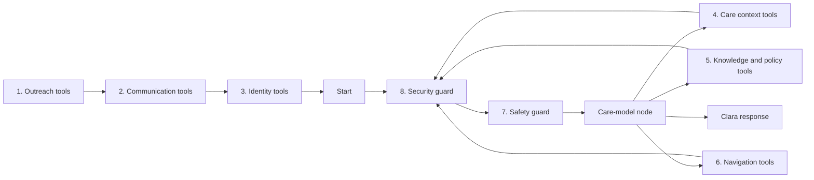

# LangChain / LangGraph workflow and tools

Clara now uses real LangGraph and LangChain, not a local imitation of their APIs.

## Read the implementation in this order

| File | Responsibility |
|---|---|
| `hcm_agent/workflows/graph.py` | Native `StateGraph`, named capability nodes, safety/security guard nodes, and bounded model/tool loops |
| `hcm_agent/agent/llm.py` | LangChain `ChatOpenAI` for the existing Azure v1 endpoint, or `ChatAnthropic` |
| `hcm_agent/tools/tools.py` | Readable capability-to-tool ownership and graph-stage tool availability |
| `hcm_agent/tools/catalog.py` | Eight families of typed `@tool` definitions and server-bound tool execution |
| `hcm_agent/tools/gateway.py` | Actor, scope, tenant context, member boundary, and in-memory audit checks |
| `hcm_agent/tools/domains.py` | Business rules and clearly identified reference adapters |
| `hcm_agent/tools/playbook.py` + `data/playbooks/diabetes_quick_care_playbook.md` | LangChain chunking, local Chroma vector index, open BGE-small embeddings, and LLM-expanded semantic retrieval for the diabetes support draft |
| `hcm_agent/tools/policy.py` + `data/policies/sbc-gpsd69bceiilo-il-2025.pdf` | Separate LangChain PDF loader/splitter, local Chroma index, BGE-small embeddings, and LLM-expanded retrieval with source page numbers |
| `hcm_agent/tools/providers.py` + `data/provider_directory.json` | Bounded specialty/location filtering over four clearly fictional Chicago-area demo providers |
| `hcm_agent/tools/scheduling.py` | In-memory local demo schedule: six daily weekday slots in America/Chicago, weekend closure, conflict checking, booking simulation, and dated alternatives |
| `hcm_agent/agent/conversation.py` | Call phases, approved introduction, emergency responses, and response guardrails |

## Eight families

Outreach eligibility; communication/accessibility; identity; care context/follow-up;
approved guidance; benefits/navigation/requests; safety/escalation; security/operations.

The stage gate exposes capability 1–2 only before a call, capability 3 during
identity verification, and capabilities 4–8 during a verified care conversation.
GPT selects relevant tools within the active stage and sees their actual results before responding.
The model receives question/answer schemas; the application binds expected identity, member scope,
policy inputs and source records. It cannot supply a different member ID or override expected DOB.

Reference tools are callable, but not live integrations. Policy lookup is grounded only in the
supplied PDF, whose plan-owner approval status has not been verified. Provider entries are fictional
demo data and must not be used for real care navigation. In explicit local demo mode, appointment
requests can reserve a simulated weekday slot in bounded process memory, with weekend/unavailable
dates returning actual next-slot dates. They are never sent to a clinic or booked in a real scheduler.
Phone requests, human-review, and urgent-alert tools report `not_configured` until real adapters are
connected. No successful bookings are claimed.

The care family includes `get_safe_outreach_brief` and `get_approved_goals`. LangChain exposes both
as no-argument tools, so the model can select them but cannot provide or alter member facts. The
application binds the current call's purpose/drivers and, when the local CLI explicitly enables
demo context, the fictional care-team summary, goals-on-file examples, and follow-up plan. Those
goals report `approved: false`; an authoritative goals service is not connected. Phone calls do
not load the dataset's fictional demo context.

The complete capability 4–6 scope is six tools only: `get_safe_outreach_brief`,
`get_approved_goals`, `search_diabetes_playbook`, `lookup_policy`,
`provider_directory_search`, and `request_appointment`. Other candidates in these three
capabilities are removed from the callable catalog. Capabilities 1–3 and 7–8 remain unchanged.

The diabetes playbook is split with LangChain's Markdown and recursive character splitters
(1,400-character chunks with 200-character overlap). The chunks are embedded locally with the open
`BAAI/bge-small-en-v1.5` model through FastEmbed and persisted in the Chroma vector store under
`data/vectorstore/diabetes-playbook` by default. The index is built lazily on first retrieval; run
`clara-playbook-index --rebuild` after changing the playbook. Set `CLARA_PLAYBOOK_VECTOR_DIR` if the
default directory is not writable (for example, on a hosted deployment). Clara's configured chat
model powers LangChain's `MultiQueryRetriever` to expand the caller's question, then the same care
agent reviews the returned CDC-cited passages and writes the answer. Retrieval is local, but query
expansion uses the configured LLM and therefore adds a model call when this tool is selected.

The tool returns matched passages with CDC source links and marks the corpus as a draft pending
clinical-owner review. Clara may use it for general support and navigation only; medication advice
is prohibited in the system prompt and checked by deterministic response guardrails. The content is
not approved for production clinical use until an appropriate owner reviews it. The local Chroma
directory is ignored by Git and is not currently a managed or shared production vector database.

## Live identity verification

Clara introduces herself and asks for a name. GPT invokes the name tool through LangGraph, then reviews
the result. First-name answers and bounded phonetic variants can pass the name step.
Clara then requests DOB; GPT normalizes the spoken date and invokes the DOB tool.
A failed tool result cannot be overridden by GPT. Missing records and mismatches end the call politely;
model/service errors get the separate unavailable message. Identity answers are masked in stored transcripts.

The phone server selects the expected member by phone number; terminal chat selects the configured
member before the simulated call. Records come from `MEMBER_DATA_PATH` or `data/demo_members.json`.
Both server and Function deployment packages include the default demo dataset.

## Outbound calls

CLI and Azure Function use `place_member_call`:
1. GPT invokes the mandatory preflight tool, which evaluates stored consent, DNC, frequency, local time and contact.
2. GPT reviews the result; approval alone cannot bypass a failed check.
3. GPT invokes the authorized ACS call tool once and reviews the actual result.

The low-level `place_call` function remains an ACS adapter, not the application entry point.
Policies stay deterministic; model interpretation never substitutes for consent.

## Usage and verification

Identity uses one tool round plus model review. General care allows at most three tool rounds,
then a final response. No external tracing/checkpointer is enabled by this implementation.
LangChain model clients allow one retry and a 30-second timeout.

Only the five offline migration tests were run:
`python -m pytest tests/test_langgraph.py -q`.
No live GPT/ACS tests or deployment were performed.

Framework references: [LangGraph workflows](https://docs.langchain.com/oss/python/langgraph/workflows-agents),
[LangChain tools](https://docs.langchain.com/oss/python/langchain/tools),
[ChatOpenAI](https://docs.langchain.com/oss/python/integrations/chat/openai).
